# Project management system

A project management system that enables efficient workforce planning. It allows assigning employees and machines to specific tasks and setting their execution times. A key advantage is the visualization of task dependencies using a graph, making planning and coordination easier. At the same time, the system is designed to be intuitive and easy to use, even for less technically skilled users.

# Features

- **Overview**: the tasks assigned to you and your personal to-do list, your schedule for the week and the hours you worked. A timer in the header logs work time, optionally on a task.
- **Projects**: a graph of the tasks and their dependencies, a task list, all files, statistics (planned vs. logged time per task and per person), a project chat and settings. Task status (done, in progress, waiting on previous tasks, not started) is shown by colour everywhere.
- **Tasks**: details, the people working on them, input and output files with previews (PDF, images, Word, Excel/CSV, text, video, 3D models STL/STEP/OBJ), the machines and the material they need.
- **Stock (Sklad)**: what is in stock, reserved and available, reservations for tasks, material requests with approval and stocking, the history of every item with a chart, and warnings when stock drops below its minimum.
- **Machines**: the production queue and schedule of each machine, the hours worked on it, service records, files and the person responsible.
- **Statistics**: your own week or month, a project's plan against reality, and your team (managers see their people, admins everyone).
- **Chat**: direct messages and a group chat for each project, with unread counts.
- **Users** (admins): accounts, roles (admin, manager, worker), teams and disabling accounts.
- Live updates across all open browsers, light and dark mode, three text sizes, and layouts for desktop, tablet and phone.

# Screenshots

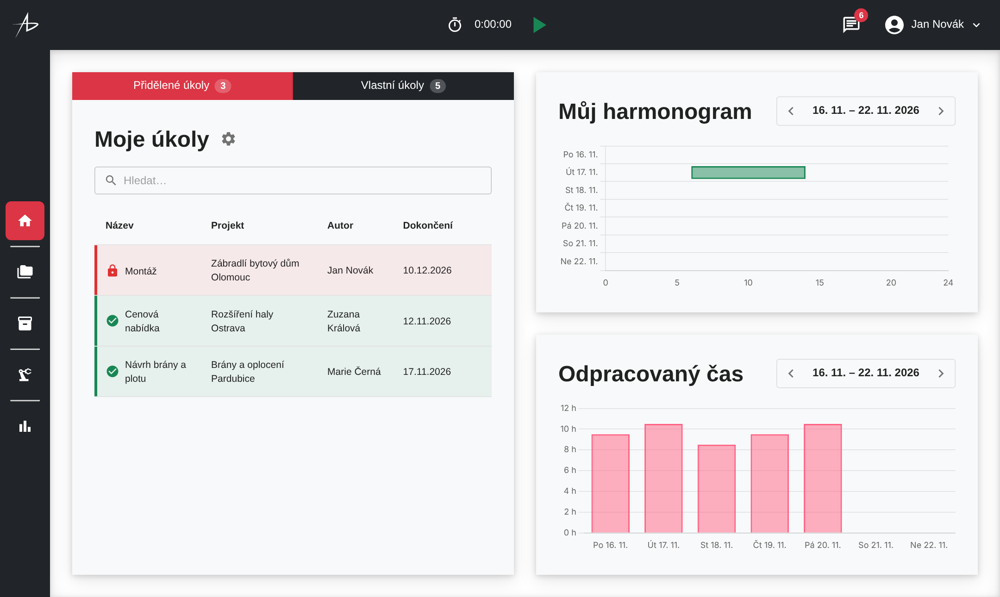

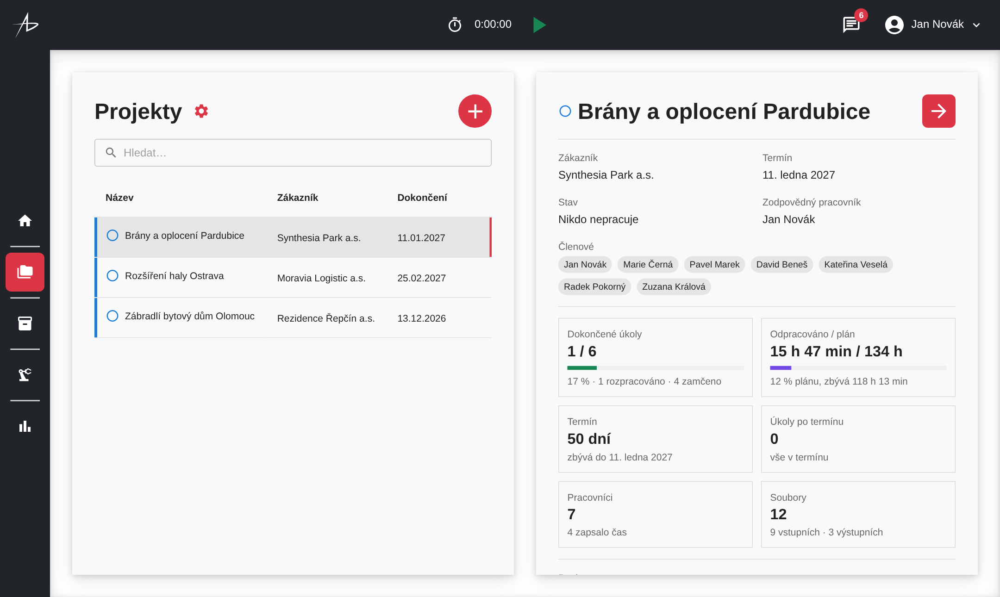

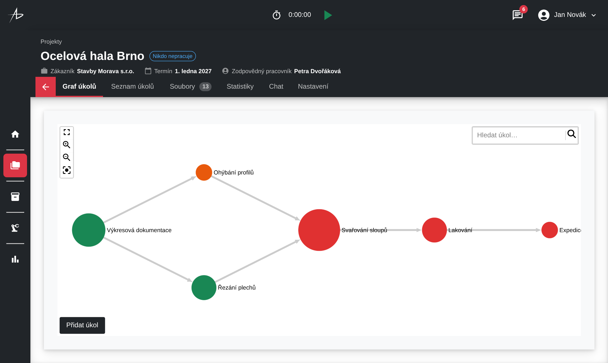

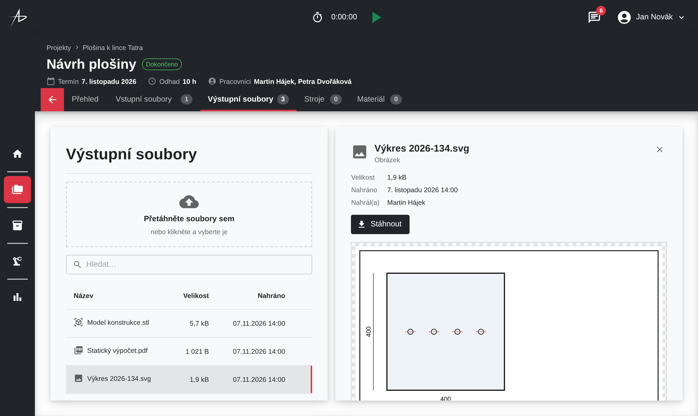

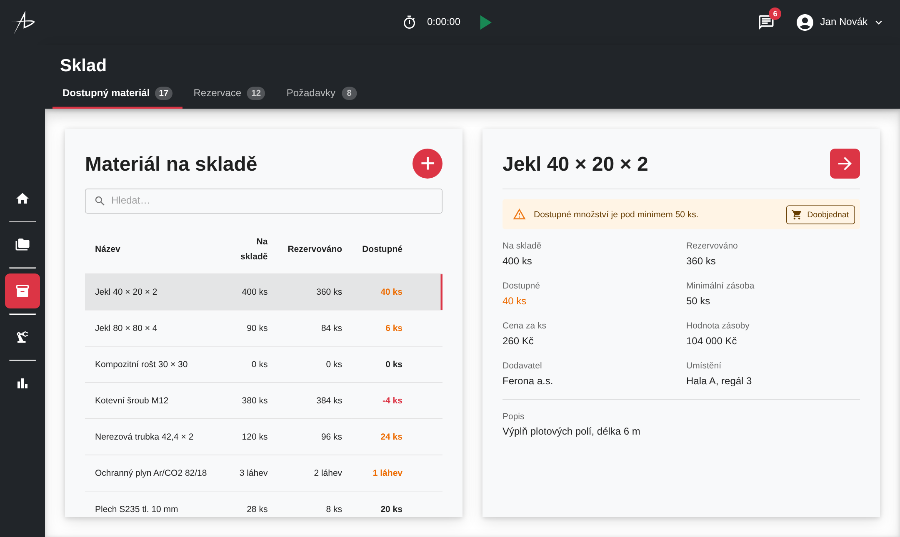

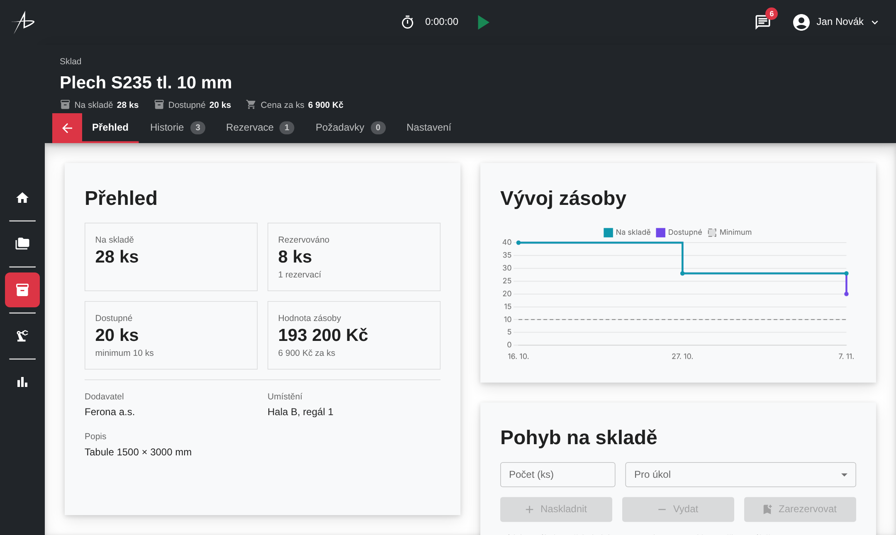

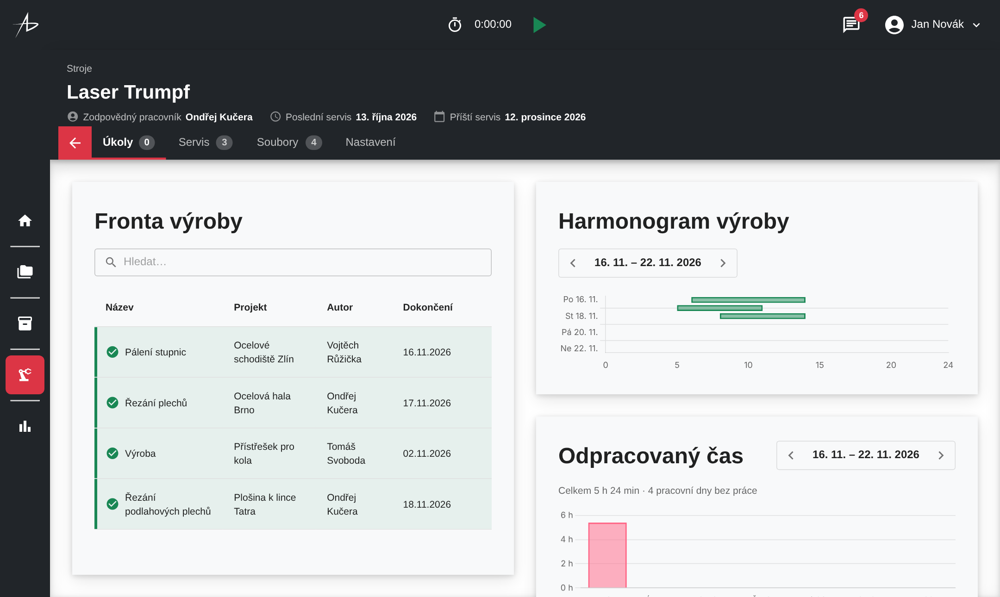

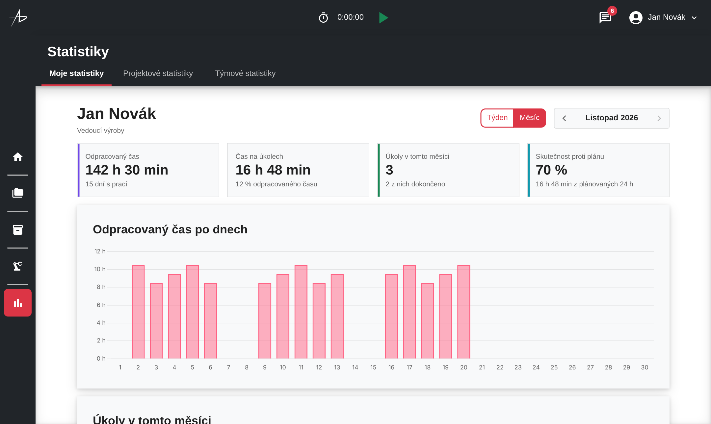

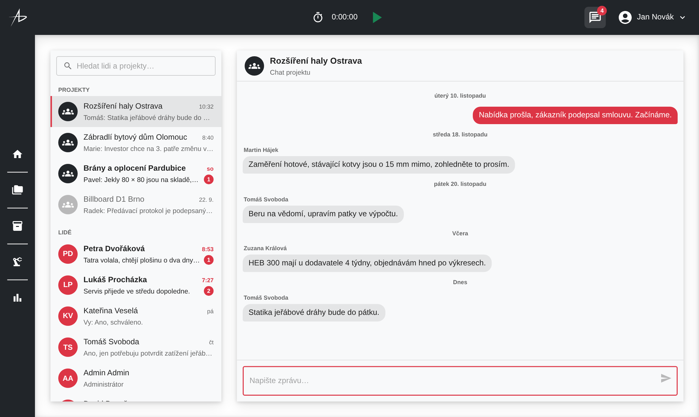

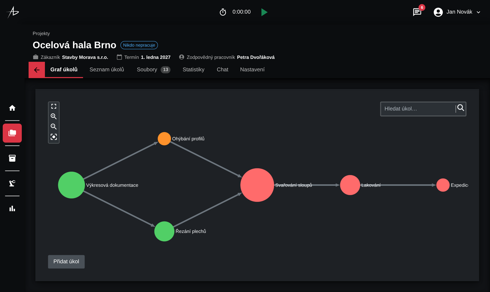

<p>
    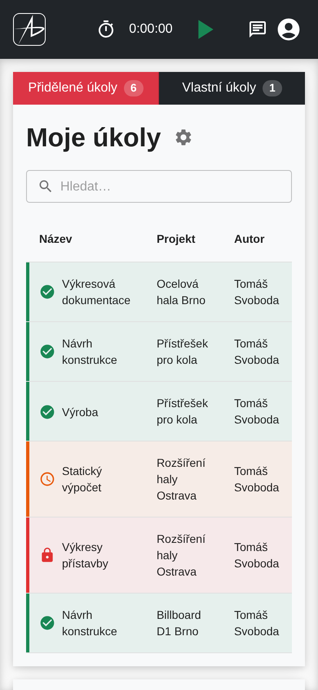
    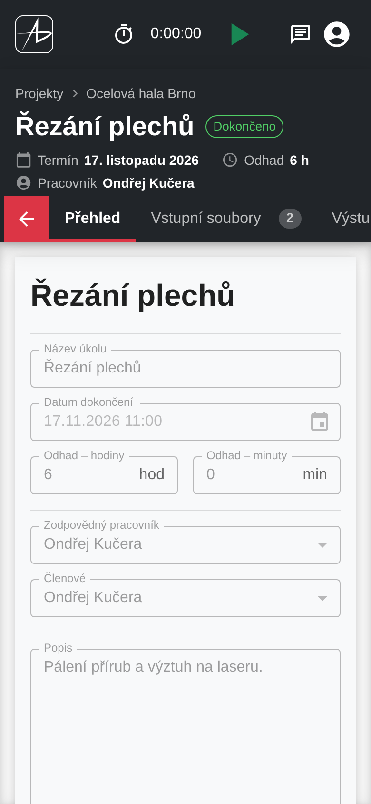
</p>

# Graphical design


# Technical design


## Live updates

The app is multi-user and live: data is read and changed over REST, and the API also runs a Socket.IO server (path `/live`, same port) that tells each open browser when data it shows was changed by someone else, as a topic such as `projects`, `project:12` or `user:5`. The screens showing that data load it again over REST; nothing is polled. A browser is only told about data its user may see (a project's tasks go to its owner, members, assignees, managers and admins; a worker's time to the worker, their managers and admins; personal tasks to their owner). The connection signs in with the session cookie and is closed when the session ends. See `backend/src/live.ts` and `frontend/src/state/live.ts`.

If a reverse proxy is put in front of the API, it must pass WebSocket upgrades on `/live/` (in nginx: `proxy_http_version 1.1`, `proxy_set_header Upgrade $http_upgrade` and `proxy_set_header Connection "upgrade"`); without them the connection falls back to long polling, which still works.

# User manual

[Here](https://github.com/Martin-Uhlik/project-management-system/blob/main/manual/user_manual.pdf)

# Development

All settings live in one `.env` in this folder, made from the template: `cp .env.example .env`. The Compose files pass each service only what it needs, and `npm run dev` on this machine reads the same file.

## Develop with Docker (no Node.js needed)

`docker-compose.dev.yml` runs the Vite dev server, the API with live reload and a dev database, all in containers:

```bash
docker compose -f docker-compose.dev.yml up
```

- Frontend on http://localhost:3000 (sign in with `admin` / `admin`, or a demo user such as `jnovak` / `demo1234`), API on http://localhost:4000, database on `localhost:5432` (`pms` / `pms` / `pms`).
- `frontend/` and `backend/` are mounted into the containers: a saved file reloads the page (frontend) or restarts the API (backend). If it doesn't (rare with Docker Desktop), uncomment `VITE_WATCH_POLLING` in `docker-compose.dev.yml`.
- On every start a one-off `migrate` container installs packages when `package-lock.json` changed, applies new database migrations from `backend/prisma/migrations` (`npm run db:deploy`) and fills an empty database (`npm run db:seed`): the first admin account and example data (users, projects with task graphs, machines, material, requests; `SEED_DEMO_DATA`, on by default here). The backend starts after it; `docker compose -f docker-compose.dev.yml logs migrate` shows what it did. For a fresh database with new example data: `docker compose -f docker-compose.dev.yml down -v`. After changing `backend/prisma/schema.prisma`, create a migration with `docker compose -f docker-compose.dev.yml exec backend npm run db:migrate -- --name <what-changed>` and commit it.
- The packages are installed inside the containers (Linux builds) into Docker volumes, never into `frontend/node_modules` or `backend/node_modules` here.
- It is its own Compose project (`project-management-system-dev`) with its own database volume; the production data in `database/data` is never touched. `docker compose -f docker-compose.dev.yml down -v` throws the dev database and the packages away.

Running commands inside the containers:

```bash
docker compose -f docker-compose.dev.yml exec frontend npm run lint
```

```bash
docker compose -f docker-compose.dev.yml exec frontend npm run typecheck
```

```bash
docker compose -f docker-compose.dev.yml exec frontend npm test
```

```bash
docker compose -f docker-compose.dev.yml exec backend npm run lint
```

```bash
docker compose -f docker-compose.dev.yml exec backend npm test
```

```bash
docker compose -f docker-compose.dev.yml exec backend npm install <package>
```

To skip typing `-f docker-compose.dev.yml`, run `export COMPOSE_FILE=docker-compose.dev.yml` in the terminal first.

## Develop with Node.js on this machine

Node.js 26 (see `.nvmrc`; the Docker images use the same version). The app has two parts, each with its own `package.json`:

- `backend/` (Express 5, Prisma 7, TypeScript): `npm install`, then `npm run dev` (uses `DATABASE_URL` and `BACKEND_PORT` from `.env`; `docker compose up -d database` starts a database for it). Apply the database migrations with `npm run db:deploy`, create the first admin account in an empty database with `npm run db:seed` (plus example data with `SEED_DEMO_DATA=true` in `.env`), and after changing `prisma/schema.prisma` create a migration with `npm run db:migrate -- --name <what-changed>`. `npm test` runs the API tests (Vitest + Supertest) against a separate database, `TEST_DATABASE_URL` or `DATABASE_URL` with `_test` added to its name (created and migrated automatically; the tests empty its tables).
- `frontend/` (React 19, Vite, MUI, TypeScript): `npm install`, then `npm run dev` (the API address is `VITE_BACKEND` in `.env`). The API's data shapes are in `src/types.ts`. `npm test` runs the unit and component tests (Vitest + Testing Library, in jsdom; no backend needed).

Both have `npm test` (Vitest), `npm run typecheck` (TypeScript, strict), `npm run lint` (ESLint), `npm run format` / `npm run format:check` (Prettier) and `npm run build`. CI runs all of them on every push and pull request.

### Databases made before migrations

Databases created earlier with `npm run db:push` already have the tables of the first migration (`0_init`). Mark it as applied once, then apply the rest:

```bash
cd backend && npm run db:baseline && npm run db:deploy
```

(In the Docker dev setup: `docker compose -f docker-compose.dev.yml run --rm backend sh -c "npm run db:baseline"`, then start it as usual. Or start fresh with `docker compose -f docker-compose.dev.yml down -v`.) Everyone is signed out once, because sessions are now stored differently.

## Security

- Sign-in sets an httpOnly session cookie (scripts can't read it) that expires after 20 hours; signing out, a password change or blocking the account ends the session. Sign-in attempts are limited per user name and per IP.
- Passwords are hashed with scrypt; older accounts are upgraded the next time they sign in.
- The API checks roles itself: admins manage users, machines and deleting projects; admins and managers manage projects, tasks, stock and material requests; users see the projects they own or belong to and the tasks assigned to them, change their own timer, password and personal tasks, and finish their assigned tasks. Every endpoint accepts only the fields it expects.
- In the public demo (`DEMO_MODE=true`) visitors share the demo accounts: only admins may change passwords, nothing can be uploaded, and every night (`DEMO_RESET_HOUR`, 3:00 Prague time by default) the database and the files go back to the demo data, keeping the admin accounts.
- Only `FRONTEND_ORIGIN` may call the API from a browser (CORS), and requests that change data from other origins are refused. The same goes for the live updates connection.

## The whole system, like in production

`docker compose up -d --build` builds the production images (nginx with the built frontend, the compiled API) and runs them with the database in `database/data`. Before the backend starts, a one-off `migrate` container applies new migrations and fills an empty database: the first admin account from `ADMIN_LOGIN` / `ADMIN_PASSWORD` in `.env` (change the password) and, only with `SEED_DEMO_DATA=true`, example data.
